# 🧠 QPG — AI Question Paper Generator

### 🔴 Live → **[qpg-questionpapergenerator.vercel.app](https://qpg-questionpapergenerator.vercel.app)**

Generate high-quality multiple-choice question papers on any topic in seconds, powered by **Groq**. The backend reads the models your Groq key can use and automatically picks the best free one (currently GPT-OSS 120B), falling back to the next best if a model is rate-limited or retired.

<p align="center">
  <a href="https://qpg-questionpapergenerator.vercel.app">
    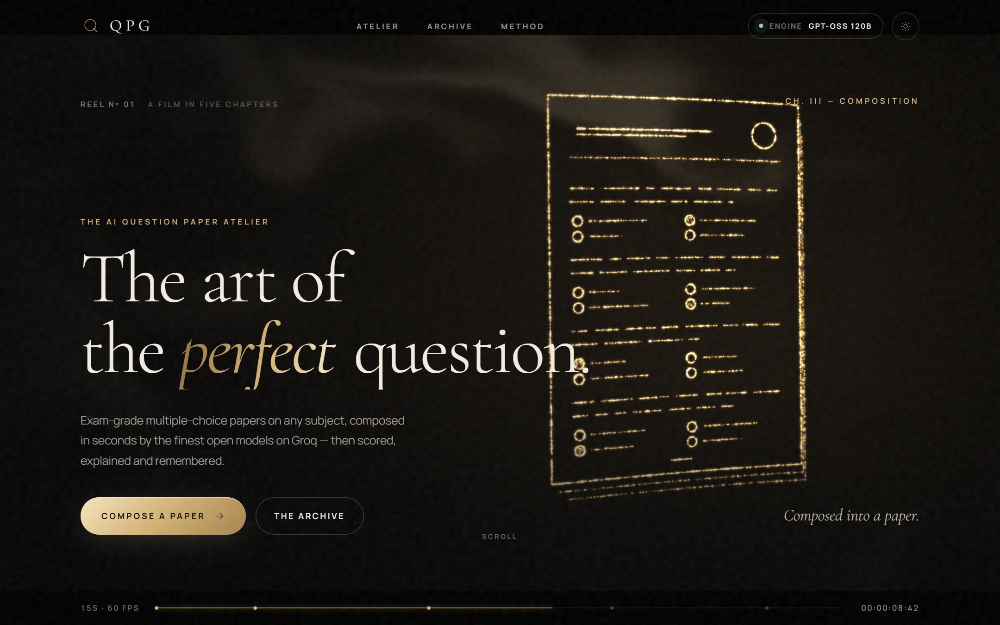
  </a>
</p>

---

# 📸 Screenshots

All screenshots are from the live site.

### The 15-second reel

The hero is a live WebGL film in five chapters that loops seamlessly. Gold particles move from dust to a sphere, then a question paper (above), then a score ring that draws a checkmark.

<table>
  <tr>
    <td width="33%">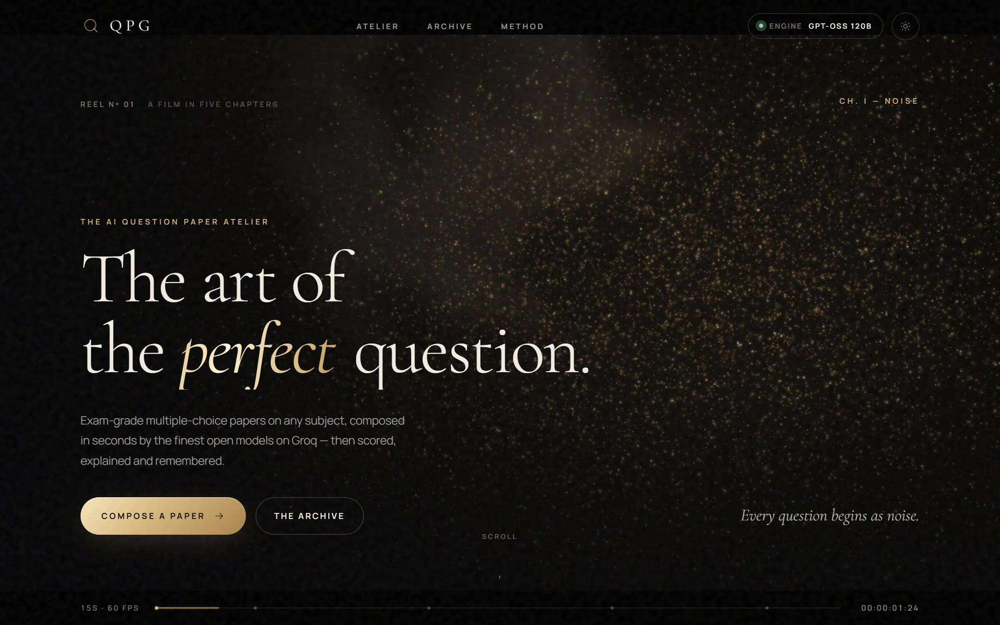</td>
    <td width="33%">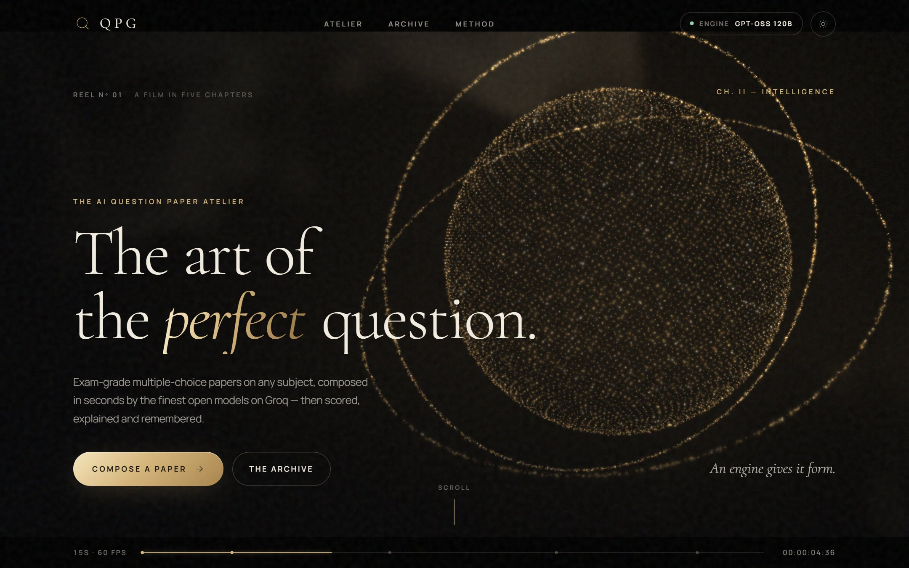</td>
    <td width="33%">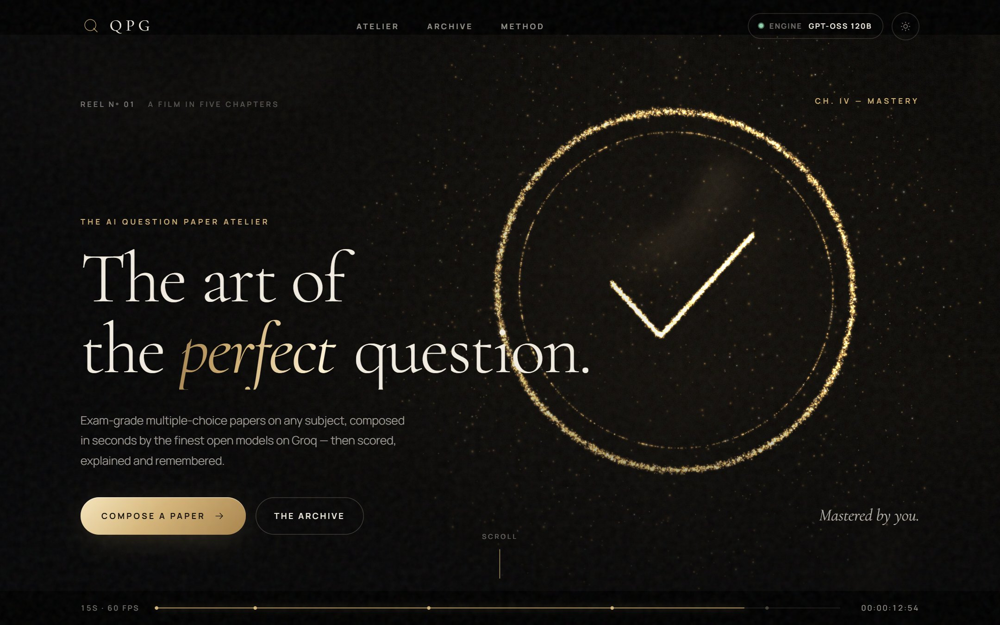</td>
  </tr>
  <tr>
    <td align="center"><sub>I · Noise</sub></td>
    <td align="center"><sub>II · Intelligence</sub></td>
    <td align="center"><sub>IV · Mastery</sub></td>
  </tr>
</table>

### Compose, attempt, master

<table>
  <tr>
    <td width="50%">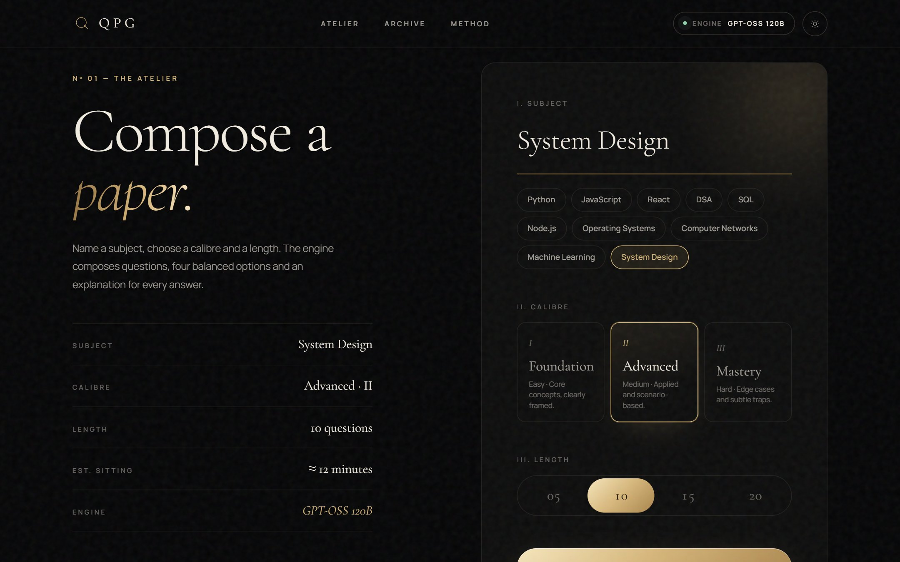</td>
    <td width="50%">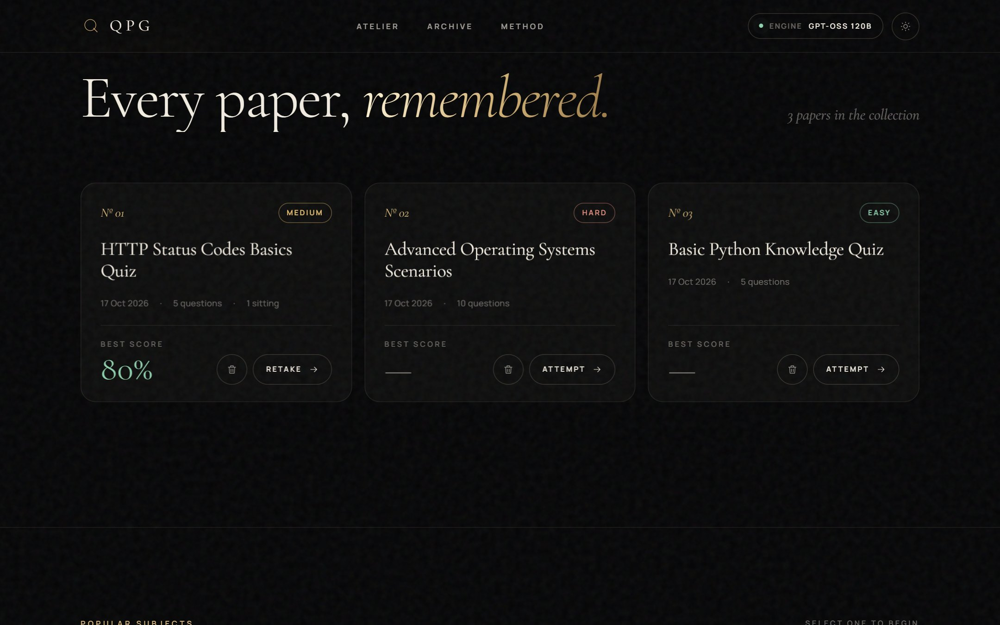</td>
  </tr>
  <tr>
    <td align="center"><sub><b>The Atelier</b>: pick a subject, a calibre and a length</sub></td>
    <td align="center"><sub><b>The Archive</b>: every paper, with your best score</sub></td>
  </tr>
  <tr>
    <td>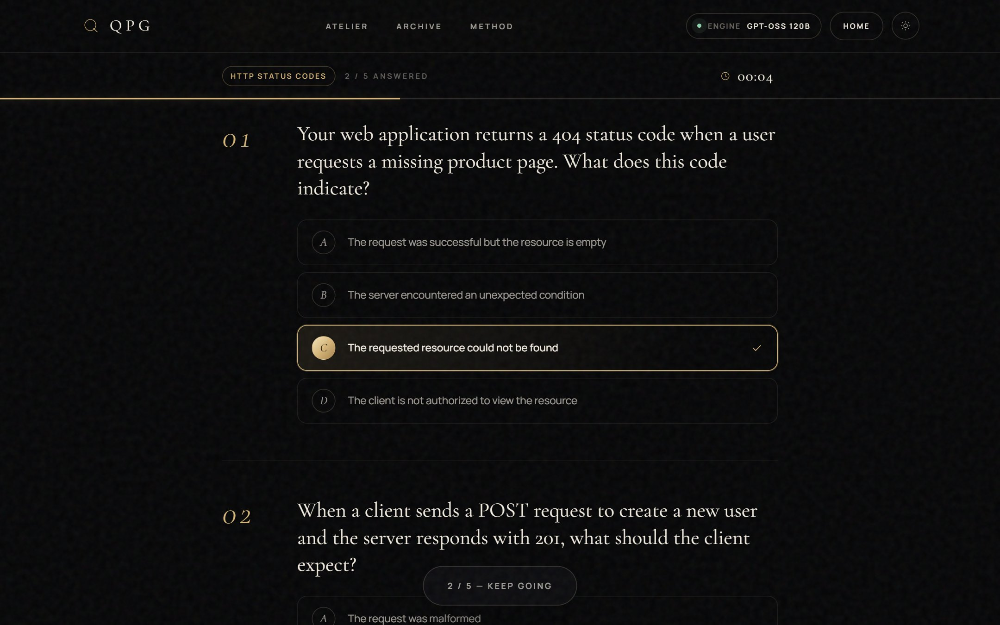</td>
    <td>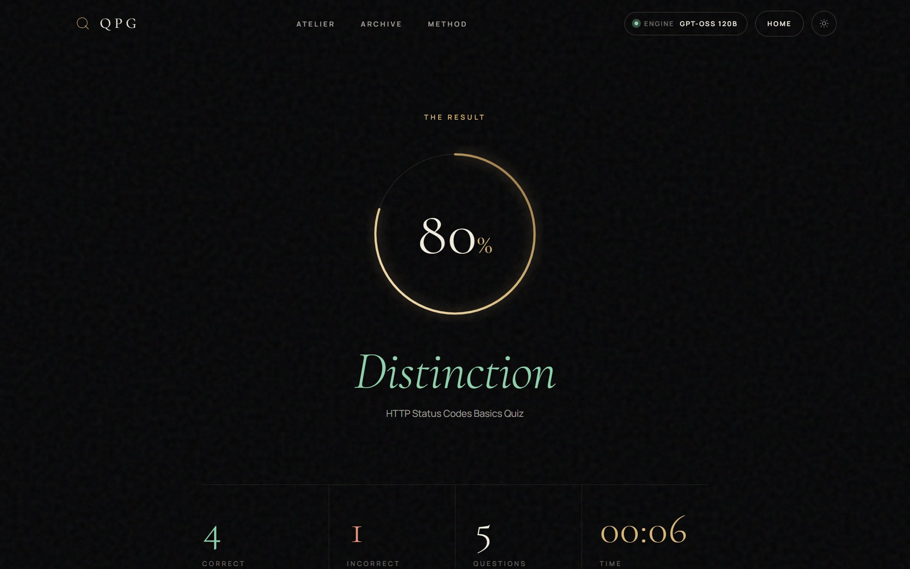</td>
  </tr>
  <tr>
    <td align="center"><sub><b>The paper</b>: distraction-free, timed, tracked</sub></td>
    <td align="center"><sub><b>The result</b>: score ring, grade and full review</sub></td>
  </tr>
  <tr>
    <td>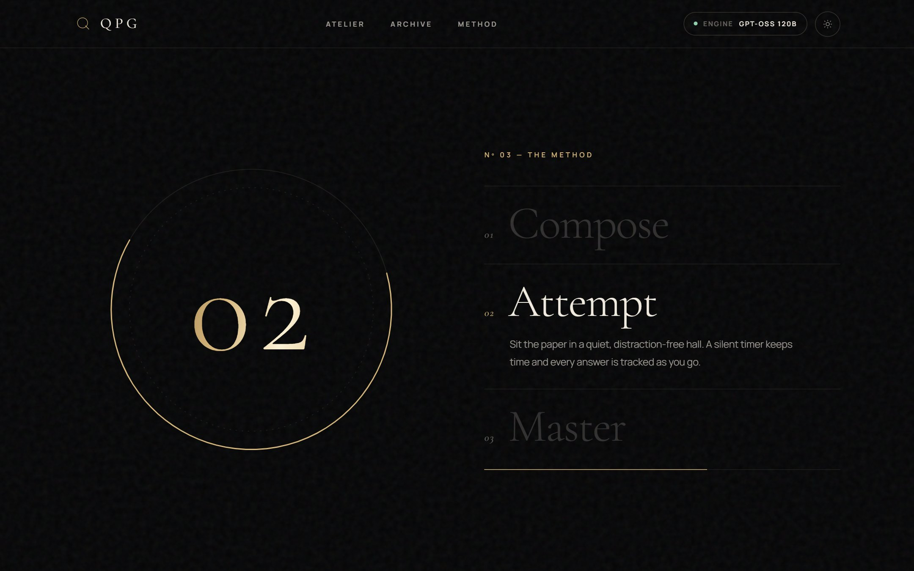</td>
    <td>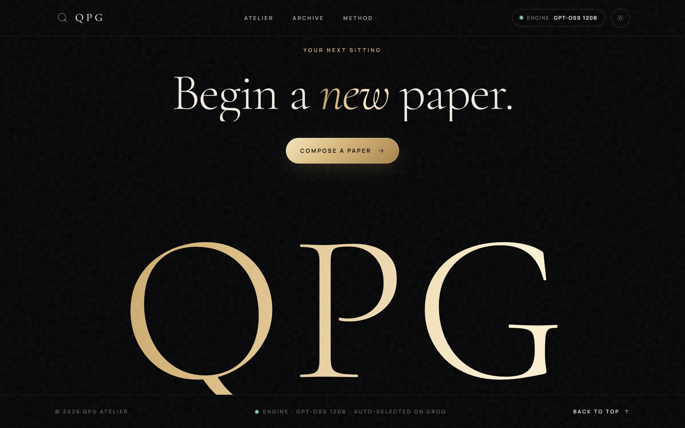</td>
  </tr>
  <tr>
    <td align="center"><sub><b>The Method</b>: a pinned, scroll-driven chapter</sub></td>
    <td align="center"><sub><b>The finale</b>: parallax gold wordmark</sub></td>
  </tr>
</table>

### Ivory theme & mobile

<table>
  <tr>
    <td width="68%">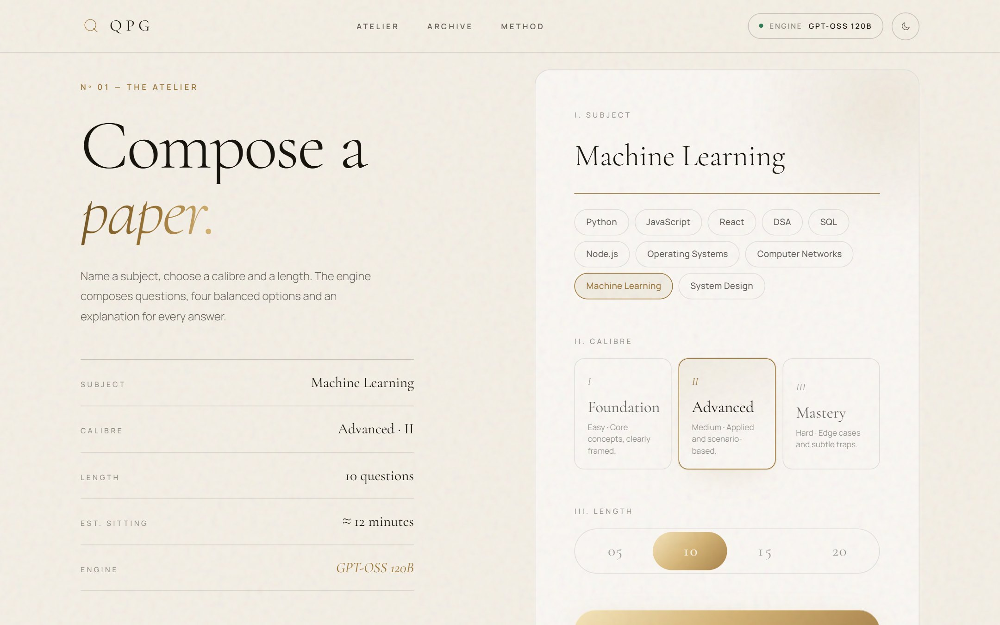</td>
    <td width="32%">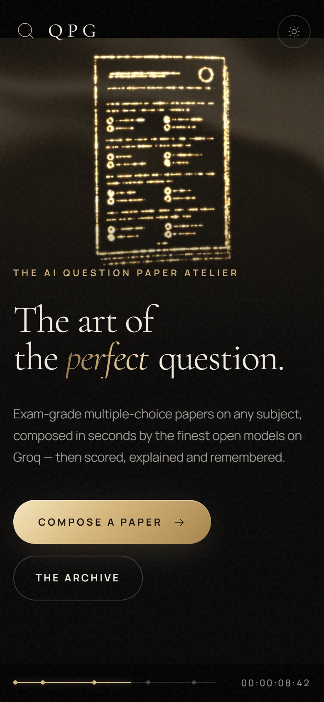</td>
  </tr>
  <tr>
    <td align="center"><sub>Ivory (light) theme</sub></td>
    <td align="center"><sub>Mobile</sub></td>
  </tr>
</table>

---

## ✨ Features

- **Cinematic hero film** — a 15-second, 60fps WebGL motion-graphics reel rendered live (five chapters, seamless loop, timecode scrubber)
- **Scroll choreography** — Lenis smooth scrolling, masked headline reveals, scroll-scrubbed manifesto, a pinned "Method" chapter, velocity marquee, parallax footer
- **Groq auto model selection** — ranks the live model list for your key, with automatic fallback on rate limits or retired models
- **Noir & Ivory themes** — black/champagne-gold and ivory/bronze, with film grain and a custom cursor
- **10 quick-topic chips** (Python, React, DSA, SQL, ML, and more)
- **3 difficulty levels** — Easy, Medium, Hard
- **4 question counts** — 5, 10, 15, 20 questions
- **Full quiz experience** — live progress bar, timer, floating submit
- **Animated score screen** — ring counter, grade badge, per-question review
- **Private archive** — papers and best scores are kept in each visitor's browser (`localStorage`), so a public deployment never mixes users
- **Dark / Light mode** toggle (persisted to `localStorage`)
- **Framer Motion** transitions throughout

---

## 🏗 Tech Stack

| Layer    | Technology |
|----------|-----------|
| Frontend | React 19 + Vite 6 |
| Styling  | Tailwind CSS v4 + CSS Variables |
| Animation| Framer Motion + Lenis smooth scroll |
| Hero film| WebGL2 (custom shaders, no 3D library) |
| HTTP     | Axios |
| Toasts   | React Hot Toast |
| Routing  | React Router v7 |
| Backend  | Node.js + Express.js |
| AI       | Groq API (OpenAI-compatible), auto-selected model |
| Storage  | Browser `localStorage` (per visitor) |
| Hosting  | Vercel (static CDN + one serverless function) |

---

## 📁 Project Structure

```
QPG-Question_Paper_Generator-/
├── api/index.js             ← Vercel function: wraps the Express app
├── vercel.json              ← build, output and rewrites for Vercel
├── package.json             ← root build script + function dependencies
├── backend/
│   ├── app.js               ← Express app (shared by local server + Vercel)
│   ├── server.js            ← local server, port 5000
│   ├── .env                 ← GROQ_API_KEY (copy from .env.example)
│   ├── lib/groq.js          ← model ranking, fallback, JSON calls
│   └── routes/
│       └── generate.js      ← POST /api/generate → calls Groq (rate limited)
│
└── frontend/
    ├── index.html
    ├── vite.config.js       ← Vite + proxy to :5000
    ├── package.json
    └── src/
        ├── main.jsx
        ├── App.jsx
        ├── index.css
        ├── api/axios.js
        ├── film/            ← the 15s WebGL hero reel (timeline, formations, renderer)
        ├── sections/        ← Manifesto, Atelier, Archive, Method, Marquee, Footer
        ├── lib/             ← Lenis smooth-scroll helpers
        ├── components/      ← HeroFilm, Navbar, Preloader, Cursor, QuestionCard, etc.
        ├── pages/           ← Home, Quiz, Score
        ├── hooks/           ← useQuiz, useTimer
        └── utils/storage.js
```

---

## 🚀 Setup & Installation

### Prerequisites

- Node.js **18+** (native `fetch` required — no extra packages needed)
- A free **Groq API key** — get one at [console.groq.com/keys](https://console.groq.com/keys)

---

### 1. Clone the project

```bash
git clone https://github.com/Rahul9994/QPG-Question_Paper_Generator-.git
cd QPG-Question_Paper_Generator-
```

---

### 2. Backend setup

```bash
cd backend
npm install
cp .env.example .env
```

Edit `.env` and add your key:

```env
GROQ_API_KEY=gsk_xxxxxxxxxxxxxxxxxxxxxxxxxxxx
PORT=5000
```

A `GROQ_API_KEY` set in your system environment also works (it takes precedence over `.env`).

Start the backend:

```bash
npm run dev    # development (auto-restart)
npm start      # production
```

---

### 3. Frontend setup

Open a new terminal:

```bash
cd frontend
npm install
npm run dev
```

Open **[http://localhost:5173](http://localhost:5173)**.

---

## 🤖 Automatic model selection

You don't pick a model. On each request the backend:

1. Lists the models your key can use (`GET /openai/v1/models`, cached 30 min).
2. Drops non-chat models (Whisper, TTS, guard/safeguard, compound systems).
3. Ranks the rest: GPT-OSS 120B → MiniMax M2 → Qwen 3.x → Kimi K2 → Llama 3.3 70B → … → GPT-OSS 20B → Llama 3.1 8B. Newer point releases of a family rank higher, and unknown future models are ranked by parameter count.
4. Tries the best one. If it is rate-limited (429), retired (404), or returns an unusable paper, it moves to the next (up to 4 models).

`GET /api/model` shows the current pick. To pin a model, set `GROQ_MODEL=<model id>` in `.env`; it goes to the front of the list and the fallbacks stay in place.

---

## 🔑 .env Example

```env
GROQ_API_KEY=gsk_xxxxxxxxxxxxxxxxxxxxxxxxxxxx
# GROQ_MODEL=openai/gpt-oss-120b   # optional pin
PORT=5000
```

---

## 📜 NPM Scripts

### Backend (`/backend`)

| Command       | Description                         |
|---------------|-------------------------------------|
| `npm run dev` | Start with `--watch` (auto-restart) |
| `npm start`   | Start in production mode            |

### Frontend (`/frontend`)

| Command           | Description                       |
|-------------------|-----------------------------------|
| `npm run dev`     | Start Vite dev server (port 5173) |
| `npm run build`   | Build for production to `dist/`   |
| `npm run preview` | Preview production build          |

---

## ☁️ Deploy (Vercel)

Live at **https://qpg-questionpapergenerator.vercel.app**. The repo deploys to Vercel as-is: the built frontend is served from the CDN and `/api/*` runs as one serverless function (`api/index.js`).

1. Go to [vercel.com/new](https://vercel.com/new), sign in with GitHub and **Import** this repository. Leave every build setting at its default (`vercel.json` supplies them).
2. Under **Environment Variables** add `GROQ_API_KEY` with your key (optionally `GROQ_MODEL` to pin a model, or `GENERATE_LIMIT_PER_15MIN` to change the per-visitor limit, default 12).
3. Click **Deploy**. Every push to `main` redeploys automatically.

`/api/generate` is rate limited per visitor, because everyone on a public deployment shares your Groq key.

---

## 🌐 API Endpoints

| Method | Endpoint           | Description                           |
|--------|--------------------|---------------------------------------|
| GET    | `/api/health`      | Health check                          |
| GET    | `/api/model`       | Model the auto-selector would use now |
| POST   | `/api/generate`    | Generate MCQs via Groq                |

### POST `/api/generate` body

```json
{
  "topic": "React Hooks",
  "difficulty": "medium",
  "count": 10
}
```

---

## 🐛 Troubleshooting

**"GROQ_API_KEY is not configured"**
→ Create `.env` inside the `backend/` folder (not the project root) and restart the backend.

**"GROQ_API_KEY was rejected by Groq (401)"**
→ The key is wrong or revoked; create a new one at [console.groq.com/keys](https://console.groq.com/keys).

**"All Groq models failed…"**
→ Usually free-tier rate limits. Wait a minute, or request fewer questions. The `attempts` field in the error response shows why each model failed.

**The hero film is a static gradient**
→ Your browser has no WebGL2. With "reduce motion" switched on in your OS, the film shows a single still frame on purpose.

**Port already in use**
→ Set `PORT=5001` in `.env` and update `vite.config.js` proxy target to match.

---

## 📄 License
 free to use, modify, and distribute.
 any collabborators and contributors are welcome
